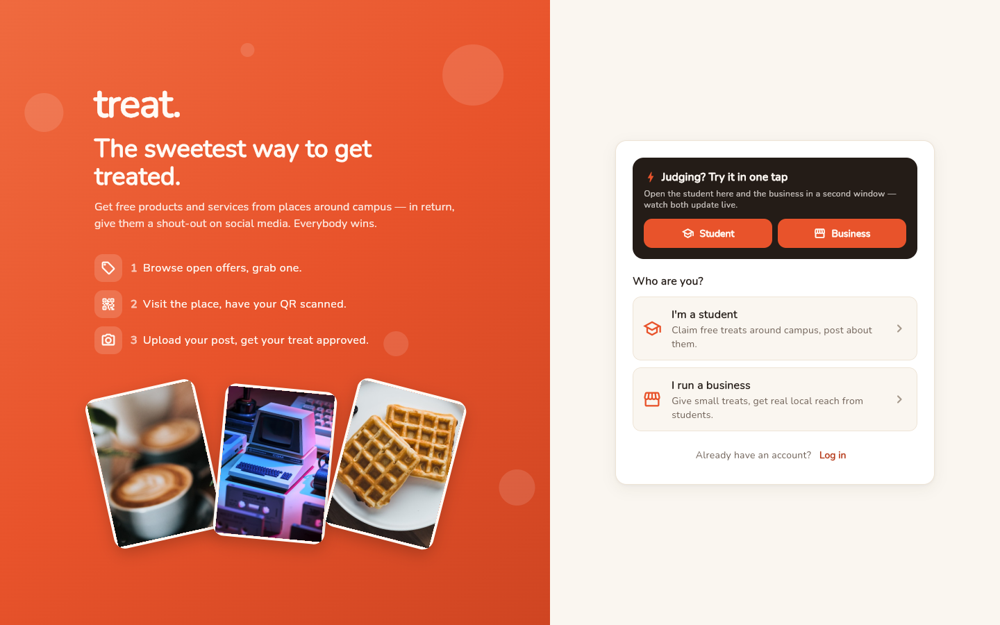
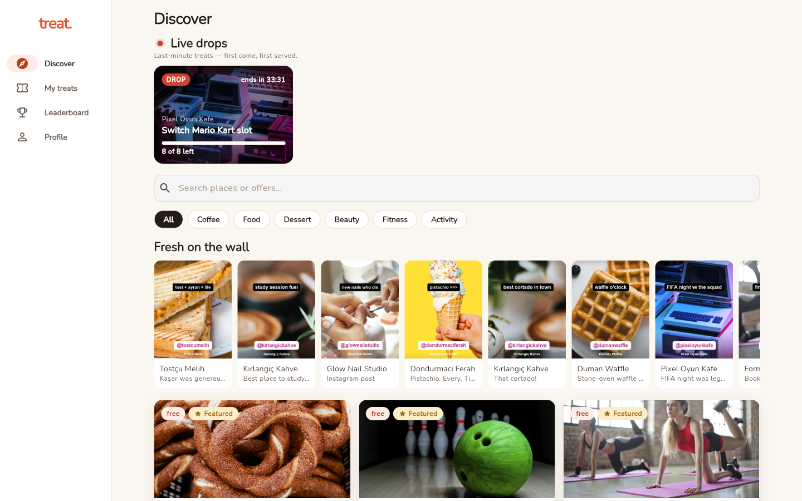
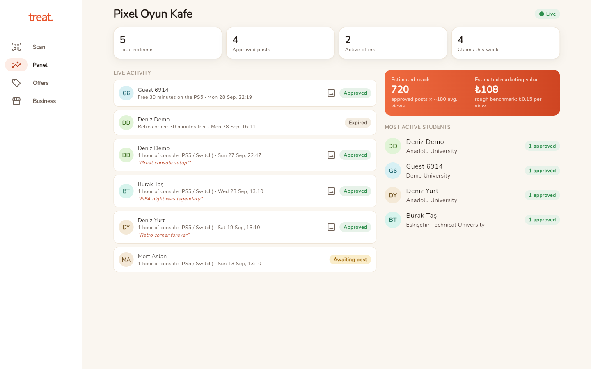
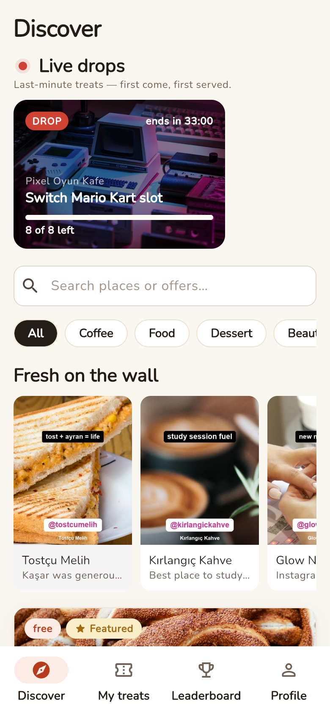
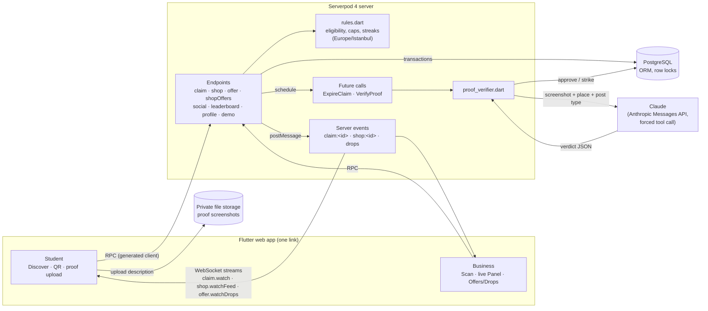

# treat.

**Students get free treats from local places. Places get real, local social-media reach. An AI checks the posts.**

A student grabs an offer ("medium filter coffee"), shows a QR code at the counter, the business scans it, the student posts an Instagram story, feed post/Reel or TikTok about the place (tagged and disclosed as a gift) and uploads a screenshot. Claude verifies the screenshot in the background and the treat is approved — or rejected with a reason and one appeal. Every step shows up **live** on both the student's phone and the business's panel. After the visit the student rates it, and every place builds a **treat score** from verified visits, plus a public page and a printable Google-review counter card.

Built for **Build Something Real: The Serverpod Hackathon** with **Flutter (web) + Serverpod 4**.

> **Live app:** https://treat-app.serverpod.space *(being deployed on Serverpod Cloud)*
> **Judging?** Tap **Student** / **Business** under *"Judging? Try it in one tap"* on the welcome screen — no sign-up, no real post needed. Details: [Demo accounts](#demo-accounts).

---

| Welcome — one-tap demo | Student: Discover |
|---|---|
|  |  |
| **Business: live Panel** | **On a phone** |
|  |  |

## The loop

| Student | Business |
|---|---|
| Browses **Discover** (search, categories). The server tells them per offer whether they can claim right now and why not (hours, daily cap, once-a-week rule, strikes…). | Creates offers: what, how often per student, active hours, daily/total caps, which posts it accepts. |
| **Claims** → gets a QR + 6-character backup code, valid for 2 hours, with a countdown. | **Scans** the QR with the camera (or types the code). Double scans count once. |
| The QR screen flips to **Redeemed** the instant the shop scans — no refresh. | The **Panel** feed lights up live: claims, redeems, proofs, verdicts. |
| Uploads a screenshot of the post → **Under review** → **Approved (+1 treat)** or **Rejected** (reason + one appeal). | Sees the proof screenshots, totals and an estimated reach / marketing value. |
| Profile: treats, week streak, badges, strikes. Leaderboard (name + university only). | |

## Architecture



## How Serverpod is used

| Feature | Where |
|---|---|
| **Endpoints + generated client** | `profile`, `offer`, `shopOffers`, `claim`, `shop`, `social`, `leaderboard`, `verification`, `demo` — all rules and authorization run on the server. |
| **Web server (Relic)** | Server-rendered `/p/:id` public place pages (link previews, schema.org data for search), `/card/:id` printable counter cards with QR codes drawn as SVG on the server, and the `/privacy` (KVKK/GDPR) and `/terms` pages; a gzip middleware for the Flutter bundle (3.96 MB → 1.13 MB). |
| **Models + ORM + migrations** | `student_profile`, `shop`, `offer`, `claim`, `report`, `identity_check` tables (`lib/src/models/*.spy.yaml`), relations to the auth user, indexes, includes. |
| **Transactions + row locks** | Claiming locks the student and the offer (`LockMode.forUpdate`) so double taps and concurrent students can't beat caps or the frequency rule. Redeem is idempotent inside a locked transaction. |
| **Streams (WebSockets)** | `claim.watch(id)` pushes the student's claim state; `shop.watchFeed()` pushes the business panel. |
| **Server events** | `session.messages` channels `claim:<id>` / `shop:<id>` fan changes out to open streams; `watch` also re-checks the DB every 5 s so a missed message (e.g. multiple instances without Redis) only delays an update. |
| **Future calls / scheduled work** | An hourly job re-checks TikToks a week after approval through TikTok's public oEmbed API and takes the treat back if the video was deleted. `ExpireClaimCall` fires at `expiresAt` (cancelled on redeem). `VerifyProofCall` (screenshots) and `VerifyIdentityCall` (student cards, business documents) run the AI check right after submit, retries with backoff, and never punishes the student for an API failure. On Serverpod Cloud's Starter plan (future calls off) verification runs in-process and resumes after a restart; expiry needs no job because the rules treat a claim past its TTL as expired. |
| **File uploads / cloud storage** | Proof screenshots go to **private** storage through upload descriptions; the server picks the path, checks type/size by magic bytes, and gives the business short-lived download links. |
| **Authentication** | Serverpod email identity provider (sign-up with terms/privacy checkbox, verification code, login) + our own student / business profiles. **Account deletion** removes the auth user in one transaction (profile, claims, reports, logins and refresh tokens cascade), deletes the screenshots from storage and revokes open sessions via `session.messages.authenticationRevoked`. `.edu` e-mails are verified automatically. Demo mode adds a one-tap sign-in that creates a guest and issues its token server-side (`AuthServices.instance.tokenManager.issueToken`). |
| **Testing** | `serverpod_test` (`withServerpod`): 135+ tests — rules, claim/redeem/expiry, live streams, proof verification with a fake AI, strikes and appeals, drops, demo sign-in and hardening, ratings, removed-post reports, post re-checks, settings, account deletion, content reports. |
| **Serverpod Cloud** | Hosting of server + Flutter web app, Postgres, storage and e-mail. |

### Rules worth knowing (`treat_server/lib/src/domain/rules.dart`)
- Eligibility order: offer inactive → not verified → 3 strikes → active claim → once-a-week/month at this place → active hours → total cap → daily cap.
- Caps and frequency are **computed from the claims table** (no counters), so an expired claim gives its slot back automatically.
- All business time is **Europe/Istanbul** (active hours, "today" for caps, Monday-based streak weeks).
- A claim costs at most **one strike**; a won appeal gives it back; a lost appeal adds none.

### AI verification (`treat_server/lib/src/ai/proof_verifier.dart`)
Claude (Anthropic Messages API, called with `package:http`) gets the screenshot plus the business name, its Instagram handle, the offer and the requested post type. The answer is **forced through a tool call** (`report_verdict`), so there is no free-text parsing. Reasons: `no_mention`, `no_disclosure`, `not_a_post`, `unreadable`.

**Compliant by design.** Posting about a product you got for free is advertising. Turkey's Advertising Board guideline for social-media influencers (like the FTC and ASA rules elsewhere) requires saying so, so an Instagram/TikTok proof is only approved when it tags the place **and** carries a disclosure such as `#işbirliği`, `#reklam` or Instagram's *Paid partnership* label; otherwise the student gets `no_disclosure` with a one-tap "copy `@place #işbirliği`" fix and can appeal. The business panel states that every approved post is disclosed.

### Why no Google reviews — and what places get instead
Google forbids reviews in exchange for anything, so treat never asks for one: a place can't pick "Google review" as a proof. What places get instead:
- **treat score** — students rate a visit (1–5, optional review, optional private note only the place sees) once the place scanned them in. Every rating is labelled *verified visit · free treat*, and it never affects the treat.
- **Public page** `/p/<place>` with the score, verified reviews and open treats — for the Instagram bio and link previews.
- **Google review counter card** `/card/<place>` — printable; the front's QR goes to the place's own Google review link for *every* customer (never tied to a treat), the back advertises its treat to students.

### Against fake posts
- AI check of tag + disclosure on every screenshot, one appeal.
- Permanent posts (feed post, Reel, TikTok) come with their **link**; the place can open them from its panel.
- The place can **report a post as removed** (48 h for stories, 7 days for permanent posts): treat taken back, strike, no appeal.
- TikToks are **re-checked automatically** after 7 days.

### Student cards and business documents
- `.edu` e-mails are verified on sign-up. Everyone else sends a photo of their **student ID card**; Claude checks it's a student card, that name and university match the profile and that it hasn't expired. Only then can they claim.
- Businesses send a **tax certificate (vergi levhası), licence or registry record** for the **verified badge**; the legal trade name often differs from the sign, so the name *or* the address must match. Renaming the place removes the badge.
- The photo sits in private storage only until the verdict and is then deleted; only the result is kept. 3 tries a day, one at a time.

### Safety for user content
- Anyone can **report** a review, a wall post or a place. A review or post reported by 2 different users leaves public pages (a review's stars still count); places are only recorded, so two accounts can't take a business off the app. Demo guests' reports never hide anything.
- Students edit their name/university and **delete their account** in Settings; businesses in the Business tab. Privacy notice and terms are linked from sign-up and both settings screens.

## Run it locally

Requirements: Flutter 3.44+ / Dart 3.12+, Serverpod CLI 4.0.2 (`dart pub global activate serverpod_cli 4.0.2`), Chrome. **No Docker needed** — Serverpod 4 runs an embedded PostgreSQL.

```bash
git clone https://github.com/thecbstudio/treat-serverpod.git
cd treat-serverpod/treat_server
cp config/passwords.example.yaml config/passwords.yaml   # add your Anthropic key
serverpod start          # server + DB + migrations + demo seed + Flutter web app
```

`serverpod start` prints the app URL. Locally no e-mail is sent: the sign-up verification code is printed in the server console (`Registration code for …`). On Serverpod Cloud the code arrives by e-mail. Tests: `cd treat_server && dart test`.

> Windows note: the first start downloads PostgreSQL (~2 min, no progress bar). If you run it from an MSIX-packaged app, set `SERVERPOD_PG_CACHE_DIR` to a folder outside `%LOCALAPPDATA%` (see `FEEDBACK.md` #4).

## Demo accounts

Created automatically on server start when `demoAccountPassword` is set (local password: `treat-demo-2026`; the production password is in the submission form).

| Role | E-mail |
|---|---|
| Student (verified) | `student@demo.treat` |
| Business — Pixel Oyun Kafe (open 13:00–23:00) | `pixel@demo.treat` |
| Business — Kırlangıç Kahve | `kirlangic@demo.treat` |
| Other businesses | `tostcu@`, `duman@`, `form@`, `yirmi7@demo.treat` |

**Fastest way to try it (two browser windows, e.g. normal + incognito):**
1. Window A: welcome screen → **Student** (one tap; every tap creates a fresh, verified guest student, so judges never block each other).
2. Window B: welcome screen → **Business** (the shared demo place, Pixel Oyun Kafe, which always has a live drop).
3. A: open the live drop → **Claim treat** → note the 6-character code. B: **Scan** → type the code. A flips to *Redeemed* by itself.
4. A: no real post needed — under *Demo: no post handy?* send the sample that **tags the place but has no #işbirliği** → Claude rejects it with *no disclosure* (strike 1/3). Appeal with the sample that **tags the place + #işbirliği** → Claude approves and the strike is returned. B's **Panel** updates live. (A third sample tags nobody at all.)

The samples are ready-made story screenshots stored on the server; they go through exactly the same upload → storage → Claude path as a real one. They only exist for demo accounts, and demo sign-in only exists while the server runs in demo mode (`demoAccountPassword` set).

## Project layout

```
treat_server/   Serverpod server: endpoints, models, rules, AI verifier, future calls, tests
treat_client/   generated client (do not edit)
treat_flutter/  Flutter web app: go_router, ARB localization, one theme
FEEDBACK.md     Serverpod 4 friction points found while building (with suggestions)
```

## Honest notes

- **Prior prototype:** the idea was tried before as a React/Firebase prototype. This is a new implementation written from scratch during the hackathon in Flutter + Serverpod; no code was copied (design tokens, copy and category photos were reused).
- **AI use:** built with Claude Code (Anthropic) as a pair programmer; all product decisions, testing and review by the author. At runtime the app uses Claude to verify proof screenshots.
- **Photos:** place cover photos are from [Unsplash](https://unsplash.com) under the Unsplash License — [bowling](https://unsplash.com/photos/YxiW_hx3lyA), [toastie](https://unsplash.com/photos/ZB8NK8cB4EE), [simit](https://unsplash.com/photos/8PV0DwdS4nU), [bookshop](https://unsplash.com/photos/ju_8CFxk6_o), [ice cream](https://unsplash.com/photos/3D0HUHFcRrk), [manicure](https://unsplash.com/photos/gb6gtiTZKB8). The demo "story" screenshots are mock-ups made from these photos for the seed data.
- Camera scanning on the web uses the browser's barcode detector (Chrome on Android); the typed 6-character code always works as a fallback.
